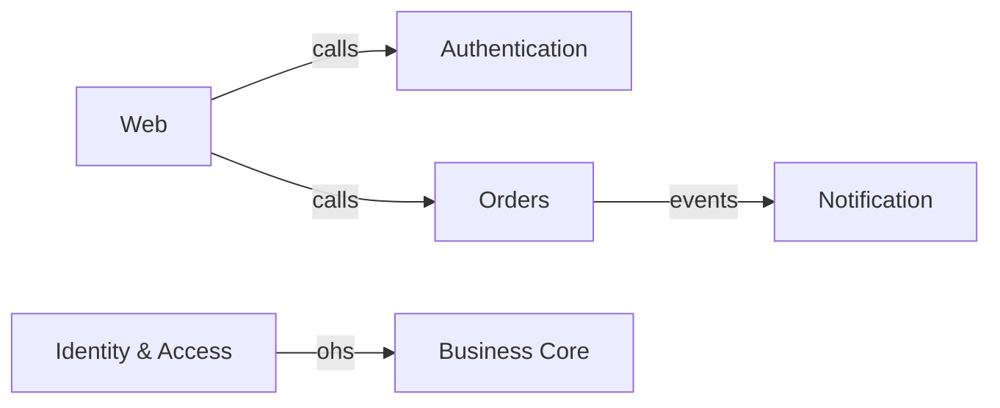
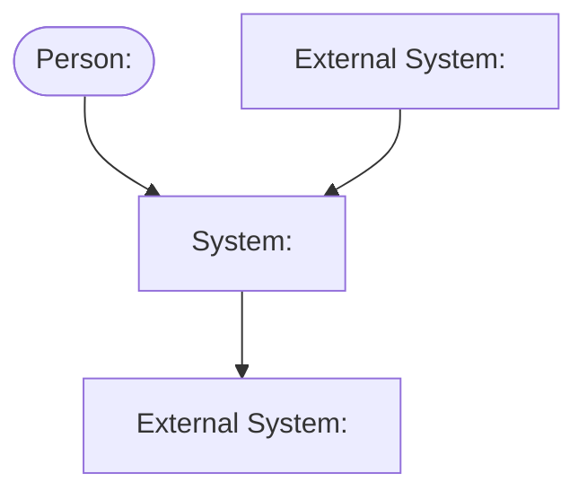
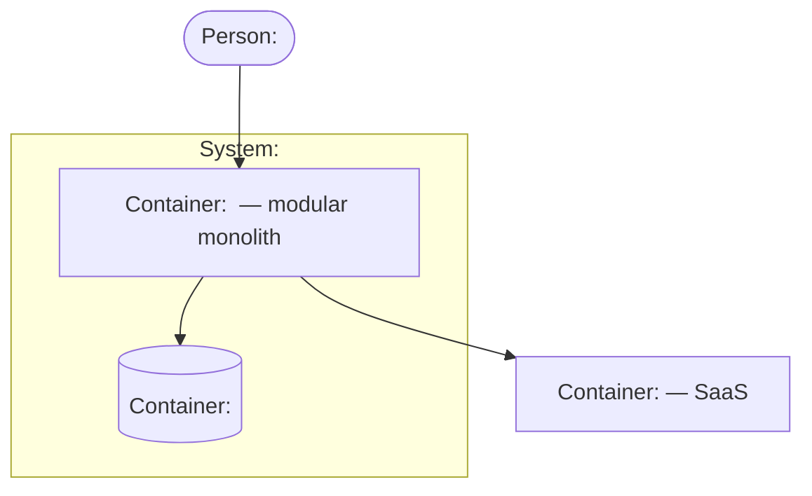

# Architecture template — `docs/architecture.md`

`/architect` Phase 4 fills this skeleton. Keep the section headings **verbatim** and the
`## Decisions` table header **byte-exact** — `backlog-check.mjs` finds the `AD-n` inventory by that
header, and `/brainstorm` reads the `AD-n` rows for the nodes a feature touches. Ids follow
umbrella D5: the first cell of a decision row is `AD-n`, the `Status` cell is `active`, `withdrawn`
or `superseded by AD-m`; ids are never renumbered, a retired row stays.

`docs/architecture.md` is the **one maintained source**. `docs/map/system.yaml` is its machine
form (nodes / links / flows — `system-schema.md`), the PRD's `## 7. Core Architecture & Patterns`
and `## 8. Technology Stack` are its digest, `.agents/memory/decisions.md` carries one pointer per
active `AD-n`. Nothing is written twice in prose.

Mermaid note: Mermaid's C4 syntax (`C4Context`, `C4Container`) renders inconsistently across
viewers, so both C4 sections use a plain `flowchart` with C4 naming in the node labels
(`Person`, `System`, `Container`) — the same diagrams render everywhere Markdown does.

Depth follows the product: a single-context CLI tool gets a two-row subdomain table and three
decisions; a multi-tenant platform gets the full set. A section that does not apply says so in one
line rather than disappearing.

The skeleton — copy from the first `---` to the end into `docs/architecture.md`:

---

# Architecture — <Product name>

**Date:** YYYY-MM-DD · **Scope:** first product slice · **Source:** `docs/PRD.md` (G/R/NFR ids) ·
`docs/discovery.md` (FL/BR ids) · **Machine form:** `docs/map/system.yaml`
**Status:** draft | reviewed (critic: ship | revise | rethink | not-reviewed — <reason> · codex: ship | revise | rethink | skipped — <reason>)

## Subdomains

One row per subdomain, classified per `.claude/skills/architect/subdomains.md` §1. The `Why` cell
cites an id or quotes a discovery line — the critic (A1) checks the citation, not the label.

| Context | Type (core/supporting/generic) | Why (evidence id/quote) |
|---|---|---|
| <context> | core | `G-1`, `FL-1` critical passes through it; "<quoted discovery answer>" |
| <context> | supporting | `BR-3` — no product satisfies it as written |
| <context> | generic | no differentiating `G-n`; constrained by `NFR-4` (data residency) |

## Context map

Typed edges, kinds per `subdomains.md` §3 (`acl`, `ohs`, `customer-supplier`, `conformist`,
`events`, `calls`). Each edge label **is** exactly one relationship kind — the model relationship
when there is one, else the transport, never `acl, calls` — and every edge is the identical
`links[]` entry in `system.yaml` (A6 checks they agree). A transport worth recording on an
`acl`/`ohs`/… edge goes into the prose under the diagram, next to the edge's `FL-n.Ak` citation.

## C4 — context

The system as one box, the people and external systems around it (plain `flowchart`, C4 naming).

## C4 — containers

Deployable units and stores inside the system boundary. With the modular-monolith default this is
one application container plus its stores and the bought services; a separate deployable appears
here only with its `AD-n`.

## Decisions

One row per decision; fields per `.claude/skills/architect/decision-dimensions.md` §3. **Header
verbatim** — `backlog-check.mjs` parses it.

| AD | Context | Dimension | Decision | Binds | Prevents | Rule | Status | Evidence |
|---|---|---|---|---|---|---|---|---|
| AD-1 | all | deployment unit | modular monolith, one deployable | every context ships as a module in the one application | per-service ops cost before the product has users | A context ships as a separate deployable only with an `AD-n` naming an independent-scaling NFR, a separate team, compliance isolation or a differing release cadence. | active | `NFR-2`, `G-1` appetite |
| AD-2 | <context> | data ownership | own schema | … | … | … | active | `BR-n` |

## Deferred

Cells decided later, each with the observable trigger that reopens it (`decision-dimensions.md`
§2). Never a date alone.

| Context | Dimension | Trigger to reopen |
|---|---|---|
| <context> | deployment unit | first external consumer of its API appears, or p95 on `FL-1` exceeds `NFR-1` |

## Stack

The chosen stack, one line per layer, each with a confidence tag (`verified` · `likely` ·
`assumption` — `stack-research.md` §5) and the `AD-n` that binds it. Research behind it:
[`## Stack research`](#stack-research) below.

| Layer | Choice | Confidence | Binds via |
|---|---|---|---|
| language / runtime | … | verified | `AD-n` |
| web framework | … | likely | `AD-n` |
| persistence | … | verified | `AD-n` |
| hosting | … | assumption | `AD-n` |

## Stack research

Sections per `.claude/skills/architect/stack-research.md` §4. The devil's advocate is **not**
written here — the critic (`architecture-rubric.md` A8) states the scenario in which the
recommendation is wrong, as a finding, if the recommendation does not already name it.

### Problem & constraints

Restated from `docs/PRD.md` / `docs/discovery.md`: goal (`G-n`), hard constraints (team, budget,
hosting, compliance — cite `PRD §9`, `NFR-n`), scale (`NFR-n` numbers), already-decided tech.

### Landscape

What exists for each layer; what was ruled out early and the constraint that ruled it out.

### Comparison

| Criterion | <Option A> | <Option B> | <Option C> |
|---|---|---|---|
| language / runtime | | | |
| hosting model | | | |
| license | | | |
| learning curve for this team | | | |
| ecosystem maturity | | | |
| cost at stated scale (`NFR-n`) | | | |
| <constraint-specific criterion> | | | |

### Recommendation

Chosen option; each point tied to a constraint above. Name the scenario in which this
recommendation is the wrong call (the critic adds it as an A8 finding otherwise).

### Risks

| Risk | Likelihood | Impact | Mitigation | Owner |
|---|---|---|---|---|
| | H/M/L | H/M/L | | |

## NFR → decision map

Every `NFR-n` from `docs/PRD.md` §6 maps to at least one `AD-n`, or says `N/A — <reason>` (A4).

| NFR | Decided by | Note |
|---|---|---|
| `NFR-1` | `AD-3` | p95 target drives the caching decision |
| `NFR-2` | `AD-1`, `AD-5` | |
| `NFR-3` | N/A — <reason> | |
