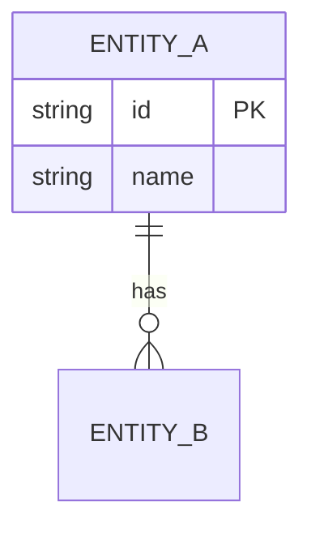

# Discovery template — `docs/discovery.md`

`/discover` Phase 5 fills this skeleton first; the PRD is derived from it. It is the working
record of discovery — coverage, every answer, the flows, the rules, the glossary, the assumptions
— and the file `backlog-check.mjs` (and later `/architect`) reads for `FL-n` / `FL-n.Ak` / `BR-n` /
`A-n` / `Q-n` ids. Id syntax is umbrella D5 exactly:

- flows: heading `### FL-1 — <name>` followed by a line `**Critical:** yes|no`;
- backbone activities: one per line, `- **FL-1.A1** — <activity>` — this list is what the story
  map in the backlog is built from, so keep one activity per line and the bold id shape exact;
- everything else: list item `- **BR-1** — …` / `- **A-1** — …` / `- **Q-1** — …`.

Ids are never renumbered; a retired id keeps its line with `(withdrawn)` appended.

The skeleton — copy from the first `---` to the end into `docs/discovery.md`:

---

# Discovery — <Project name>

**Date:** YYYY-MM-DD · **Mode:** interview | import · **Project type:** greenfield product |
internal tool | integration | data / AI | existing codebase extension
**Sources:** <`.agents/sources/<file>`, imported `<path>` (rows n), or "conversation only">

## Coverage

| Category | Status (Clear/Partial/Missing/Deferred) | Notes |
|---|---|---|
| Functional scope & behaviour ★ | | |
| Domain & data model ★ | | |
| Interaction & UX flow (incl. error / empty / loading) | | |
| Non-functional qualities ★ | | |
| Integrations & failure modes ★ | | |
| Edge cases & failure handling | | |
| Constraints & tradeoffs | | |
| Terminology | | |
| Completion signals ★ | | |
| Misc / placeholders & vague adjectives | | |
| Stakeholders & decision rights | | |

## Clarifications

### Session YYYY-MM-DD

- Q: <question as asked> → A: <answer as given; "Recommended accepted" when the user said yes>
- …

## Stakeholders

| Role | Uses | Pays | Approves | Operates | Name | Decision latency |
|---|---|---|---|---|---|---|
| … | | | | | | |

**Decision owner:** <role / name>.

## Flows

One `### FL-n` per flow. The critical flow is the one end-to-end scenario that must work. When the
product replaces a process, draw the as-is first, then the to-be; the backbone activities are
taken from the to-be.

### FL-1 — <name>

**Critical:** yes
**Actor:** <primary role> · **Trigger:** <what starts it> · **Outcome:** <what is true at the end>

Backbone activities (left to right in the story map):

- **FL-1.A1** — <activity>
- **FL-1.A2** — <activity>
- **FL-1.A3** — <activity>

To-be:

```mermaid
flowchart LR
  subgraph User
    A1[<activity 1>] --> A2[<activity 2>]
  end
  subgraph System
    S1[<system step>]
  end
  subgraph <Other role / external system>
    X1[<step>]
  end
  A2 --> S1 --> X1 --> A3[<activity 3>]
```

As-is (only when replacing a process):

```mermaid
flowchart LR
  subgraph <Role>
    B1[<manual step>] --> B2[<wait / handoff>]
  end
```

Exceptions: <what goes wrong, how often, who handles it — each becomes a `BR-n` or an `R-n`>.

### FL-2 — <name>

**Critical:** no
…

## Glossary

| Term | Definition | Avoided synonyms |
|---|---|---|
| <term> | <one sentence> | <words not to use for this> |

## Business rules

- **BR-1** — <rule> · source: <who said it / which source file:row> · example: <concrete case> ·
  exceptions: <when it does not apply, or "none">
- …

## Entities



Source of truth per entity:

| Entity | Source of truth | Identity | Lifecycle (created / changed / ends) | Retention |
|---|---|---|---|---|
| <entity> | <system / this product> | <key> | <…> | <…> |

## Assumptions

- **A-1** — <assumption> · confidence H/M/L · owner <role> · validate by <date | event>
- …

## Open questions

- **Q-1** — <question> · owner <role> · blocks slice 1: yes | no · <accepted as open by <owner>,
  when applicable>
- …

## Risks & pre-mortem

**Pre-mortem** (six months later, it failed — why): <the answer, verbatim where possible>.

| Risk | Likelihood | Impact | Rests on | Cheapest test / mitigation | Owner |
|---|---|---|---|---|---|
| <…> | H/M/L | H/M/L | `A-n` | <…> | <role> |

## Definition of Ready

The checklist from `.claude/skills/discover/coverage.md` §4, ticked honestly. An item satisfied
by an owner accepting an open question names that `Q-n`.

- [ ] Problem, users and the current alternative are stated.
- [ ] At least one `G-n` with a target value and a date.
- [ ] Appetite and what gives first when it overruns.
- [ ] NOT list — non-goals with rationale.
- [ ] Stakeholders mapped; decision owner named with latency.
- [ ] Key journey drawn as a to-be `FL-n` with `FL-n.Ak` activities, one flow `**Critical:** yes`,
      `BR-n` for the rules it depends on.
- [ ] Glossary consistent.
- [ ] Entity sketch with a source of truth per entity.
- [ ] Measurable `NFR-n` for every applicable ISO/IEC 25010 characteristic; the rest N/A with
      reason.
- [ ] Compliance flags resolved or logged as owned risks.
- [ ] Top risks have owners.
- [ ] No critical category (★) is Missing.
- [ ] Every open question is an owned `Q-n`; none blocks slice 1 (or the block is accepted in
      writing).
